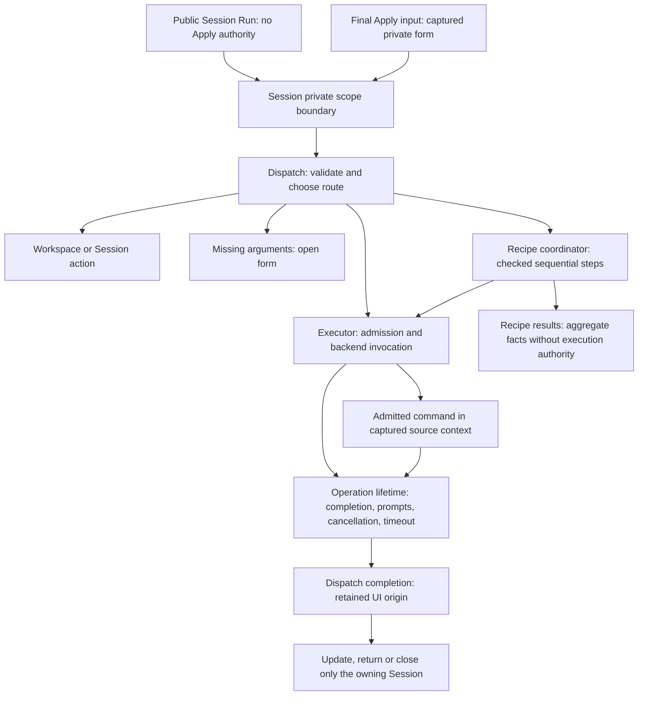

# Architecture and execution

Audience: maintainers. This describes execution, workflow and public-service
ownership. Portable protocols and user configuration schemas have separate
contracts. See the compatibility guide for host scope and known limitations.

## Core, hosts and tools

RE35 connects command discovery, inputs, execution, Results and recovery through
stable command identities. A profile declares the user's workflow; the host
resolves local resources and carries out the admitted operation.

| Layer | Location | Owns |
| --- | --- | --- |
| Portable Lua core | `lua/command_environment/core` | Command data, argument rules, document coordinates/plans, profile/workflow validation, provider reports, follow-up proposals and presentation resolution |
| Neovim host | `lua/command_tree`, entered through `lua/re35.lua` | Session/workspaces, live buffers/windows, settings storage, LSP/plugin adapters, execution and owned Tasks/Results |
| VS Code development host | `hosts/vscode` | Native controls, document revisions, local project/tool mapping, execution and host-owned Results/recovery |
| Optional native bridge | `native/ce.c`, `native/ce.h`, `native/stdio.c` | Bounded transport and a Lua 5.1 runtime loading the same core sources |
| Optional process owner | `native/process_scope.c` | Windows Job or Linux group ownership, separately from the core bridge |

Neovim calls shared modules in process; its Session is a host implementation,
not the portable Engine running inside another UI. VS Code reaches shared data
operations through Protocol 1 and C ABI 1. C++/C# console examples demonstrate
embedding that core. They do not supply a complete editor host.

The core produces data and validates semantics. Live document versions, physical
paths, executable identities, UI callbacks and permissions stay with the host.
Portable profiles preserve declarations, including unsupported preferences;
Tasks, live receipts and machine paths are not transferable profile state.
See [coverage](../command-coverage.md) for current host differences and
[portable core](../portable-core.md) for transport/build requirements.

Existing engines provide capabilities: ripgrep can produce structured search
results; editor APIs perform edits and LSP operations. A plugin-owned picker is
an explicit handoff. Integration should retain command/source/provider identity
and completion evidence wherever the backend exposes them.

## Neovim call direction

The diagram shows responsibility and call direction. A running task can outlive
its UI; not every completion returns to an open Session. Input and cancellation
can be synchronous or delayed. A cancellation request is not proof of exit.

## Neovim owners and functions

| Module | Responsibility | Entry or stages |
| --- | --- | --- |
| `session.lua` | Session coordination, private shared execution scope and Session API | `prepare`, `open`, `run`, lexical `run_scoped` / `dispatch_submission`, private `execution_scope`, `consume_submission` |
| `session/dispatch.lua` | Command routes and origin-aware UI completion | `run` -> workspace/action/form or `execute`; recipe dispatch and `completion` |
| `executor.lua` | Command admission, target/argument checks, backend invocation, pending-key ownership and bounded finished history | `execute`, `list`, `cancel`, `force_cancel` |
| `executor/lifetime.lua` | One admitted operation's completion, input/select requests, cleanup, cancellation and timeout | private `finish`, `request`, `stop_backend`; operation methods and `start_timeout` |
| `project/recipe_execution.lua` | Original target, parent and current child, sequential stages, dispatch and cancellation decisions | `execute_recipe`, `next_step`, parent cancellation hooks |
| `project/recipe_results.lua` | Result defaults, observed step facts, child IDs, partial diagnostics and bounded location summaries | `new`, `observe`, `add_child`, `finish_locations` |

Input, Navigation and Presenter remain separate Session modules. Project
selection, Tasks history and Results location ownership stay distinct. Recipe
Model/Workspace/Recovery responsibilities are not merged into the coordinator.

`session/lifecycle.lua` owns logical identity, suspension, fresh source attachment
and final disposal. `session/input_driver.lua` owns polling and the leased paste
hook; `session/input.lua` owns argument forms. Editor detaches the surface while
retaining safe navigation and nonsecret drafts. Resume does not retain input,
review, completion or recovery authority. Workspace stacks and native prefix
replay must finish before suspension. Failed final cleanup retains a disposal-only
owner for known views; workspace leave hooks are not replayed to retry those views.

Executor prompt/completion callbacks, private Apply scope and workspace API
closures check the captured attachment. A retired loop cannot close a reattached
logical state. Late foreign paste wrappers may forward complete, non-streamed
native pastes (phase -1) only when all RE35 attachments have detached;
retired stream fragments and any
attempt to bypass another live attachment are rejected.

## Boundaries to preserve

`view/model.normalize` converts local window options and negotiated presets to
one host display model. Its compatibility provenance preserves legacy width,
row ceilings, placement and spacing without rewriting saved profiles.
`view/panels.prepare` reserves main/detail regions and pure `view/guide.plan`
places optional controls. The single `view/presentation.plan` then derives
content geometry, row costs, page size and all-page review admission. Drawing
and fresh admission use that calculation; a cached plan does not authorize
Apply after resize. Mandatory facts stay in the main panel. A failed guide
retains its below-panel fallback for fresh validation until a normal redraw
recovers it. `View.draw` remains the public entry; there is no separate legacy
renderer or critical-scene renderer promotion.

Opt-in native `input_ui` hooks provide a picker draft and bounded status text;
they are host callbacks, excluded from portable command metadata. Returns are
bound to the live attachment, descriptor, input and field. Closing, reattaching
or replacing them during a callback retires its output before preview or draw.
Picker controls never provide Apply authority; acceptance remains explicit.

- Only the lexical final Apply callback supplies a captured submission. Public
  Run always suspends shared execution authority, even when entered from another
  Session. Return and exception paths restore the enclosing scope.
- There is no exported approval mint/setter. `consume_submission` requires the
  exact live form, command descriptor, context, arguments and operation. It
  consumes once. Availability/validation hooks do not gain execution authority.
- The invocation boundary activates only after Executor admission. Changed form
  arguments, context or input identity cannot use the earlier captured receipt.
- Lifetime commits terminal state and releases its own pending key before
  cleanup or user completion callbacks. Cleanup may admit a replacement task;
  the finished task must not remove that replacement's pending ownership.
- A prompt can answer before returning its cleanup function. Fast-event
  completion is queued once. Timeout establishes its reason before calling a
  stop hook which might complete synchronously.
- Recipe result collection cannot launch, cancel or choose the next step.
  Parent/child lifetime and cancellation decisions remain with the coordinator.
  Partial child diagnostics and the aggregate limit remain visible.
- Environment replacement can preserve running Executor jobs. Old invocations
  retain their admitted usage destination and context. Execution receipts do not
  cross into a replacement environment. Read-only Task inspection may follow
  the exact retained operation into the live environment; an ID match alone is
  insufficient.

## Recipe integration

Public module contract: `validate(projects, recipes) -> normalizedProjects,
normalizedRecipes | nil, reason`, `register(env) -> manager`,
`definition(manager) -> Project workspace replacement`.

Manager methods: `context(ctx, selection)`, `select_root(id, path)`,
`resolve(recipeId, ctx, selection, pinnedRoot)`, `validate_target(plan)`,
`run(recipeId, selection, ctx, options)`, `rerun(operation, options)`,
`available_selected(ctx)` and `run_selected(ctx, options)`.
`diagnose(recipeId, ctx)` exposes checked tool readiness and a declaration route;
it does not infer the cause of an arbitrary process exit.
`project_task.review(operation, command, env, options, dispatch?)` preserves
ordinary rerun behavior. `capture` / `check_snapshot` expose data-only
source-disk and source-buffer identity checks between child steps. They do not
snapshot loaded project buffers or claim to freeze compiler dependencies.

Prepare integration registers recipes after ordinary Project commands and
replaces Project before workspace overrides are configured. Session receives
the prepared manager; runtime callbacks use `env.session` after preparation.
Semantic parent commands carry `recipe_id` and request review only when no
already-reviewed `process_target` is supplied. A running pipeline retains its
Executor and parent operation. After environment replacement, a private
registry-to-manager association admits continuation only through the live
manager's exact registered parent/child descriptors and an equivalent execution
plan. The retired manager cannot dispatch a stale callback into the new registry.

Internal `recipe.<recipe>.step.<step>` commands are hidden and accept only the
authorized pending parent task, exact argv and target. Invoking them independently
cannot start work. Both semantic parent dispatch and Project Review/run must use
the same checked file-save flow. With no modified loaded project files, the
explicit Run or retained retry dispatches checked saved inputs directly.
`force_review = true` requests the save-policy chooser even for clean inputs;
modified files always keep that chooser unless the caller already supplies an
explicit `save` policy.

Project Run remembers its four displayed logical IDs for the source window.
`project.run_selected_recipe` resolves that complete selection afresh and refuses
incomplete or foreign-window choices. Its default `rr` binding yields to existing
bindings and later profile overrides. It stores no target plan or absolute root
in the portable quick slot; retained retry remains the original task's operation.

One parent runs one owned direct child at a time. Parent/child IDs, ordered step
states, direct termination scope and locations are data-only snapshots; process
handles remain on owned operations. A rerun rechecks declaration revision,
source identity, root markers, relevant disk-profile declarations, current UI context
and duplicate same-target execution before saving or starting. Direct child exit
is not evidence that all descendant processes have terminated.

Host registration binds a private execution-scope resolver to trusted Project
descriptors. Recipe signatures include their project, ordered recipe, effective
referenced tools and process ownership policy. Appearance, aliases and other
tools do not invalidate them. Unknown custom commands retain conservative
whole-context checks; profile policy labels cannot grant a relaxed scope.
Settings writes retain their separate whole-profile optimistic conflict checks.
Selected saves validate the entire chosen set before the first write, then each
record immediately before its write. A final native BufWritePre guard rejects
path redirection and disk/permission drift after ordinary formatting hooks.
This is a checked native save, not a sandbox for arbitrary plugin callbacks or
custom BufWriteCmd side effects. Partial failures report already-saved files.

Original-task recovery receipts live in a weak map keyed by retained operation,
separate from profile data and workspace memory. Capture copies physical
root/source identities from the already admitted target; it must not resample
the filesystem to redefine that identity. Resolved plans include canonical root,
directory device/inode and physical source path so ordinary target validation
rechecks the identity at save and dispatch, including unnamed root-level recipes.

Temporary task review permits current tool changes while refusing changed recipe
or project declarations. It fixes original logical choices, never replaces
`manager.selections`, and suppresses remembered-state writes. An active ordinary
Project frame is covered by Tasks before opening a distinct review frame rather
than being reused. Context selectors are read-only. The fresh launch uses the
normal checked save/dispatch path with `force_review = true`; the old task and
ordinary replay evidence remain unchanged.

## Backend recovery ownership

The recovery receipt is bounded process-local data. It is excluded from Workspace
memory and portable export; closing Settings discards it. Navigation-only Return
checks the original buffer/window/name and bounded navigation owner, then
refreshes context and availability. Cursor, text and filetype changes alone do
not block inspection. The dormant query's later explicit Run separately checks
the original document, root, command, profile, runtime bindings and query.

Replacing a command after Return prevents a dormant query from executing through
the replacement. A late selector callback from a closed Settings owner cannot
stage or execute anything in a replacement session. Recovery never selects an
automatic fallback or launches the original command.

A one-use Apply-return token is admitted only for a successful single change of
the captured backend capability. After the environment rebuild, the new Settings
owner and descriptor are checked again before navigation-only return. Its
retained query remains dormant until explicit Enter. Generic edits, Undo,
Reload and multiple changes do not receive this automatic-return authorization.

Simplifying review/navigation must preserve these ownership checks. The number
of review screens is not itself a safety invariant.

## VS Code workflow owners

The optional desktop host has a separate native UI and live execution owner;
the shared core still validates portable data. This table describes call
direction rather than changing the Neovim modules above.

| Module | Responsibility | Stages |
| --- | --- | --- |
| `workflow.js` | Profile/project selection and context/execution revisions | preview/apply, prepare/commit selection, invalidate |
| `task-plan.js` | Fresh local executable, argv and cwd resolution | resolve, revalidate |
| `task-inputs.js` | Saved file/editor ownership and explicit selected Save | capture, compare, save-selected |
| `task-service.js` | One-use admission, original context, core completion and four retained Tasks | prepare current/original, validate, start, launch |
| `task-sequence.js` | One active child across sequential steps | start, next step, cancel/force, terminal snapshot |
| `task-results.js`, `result-locations.js` | Bounded diagnostics and private source navigation | capture, retain, jump/revalidate |
| `task-recovery.js` | Private follow-up menu/selection and fresh original admission | actions, select, dispatch |
| Native workflow/recovery/task/results UI modules | Native input and origin-aware navigation | inspect, Return, explicit Run/dirty-input choices |

Recovery uses the existing Task admission and sequence owner; it introduces no
second executor. Shared proposals carry display data only. Native controls
call host services, and Results/recovery transitions use injected callbacks
rather than cyclic module imports. Lazy service creation keeps document-only
execution independent of recovery/process state. Asynchronous admission and
process lifecycle remain complex even with these smaller responsibility scopes.

## Configuration and public services

`require('re35')` returns the same API table as `require('command_tree')`.
Both names reach one lifecycle owner; there is no parallel environment or profile
migration. The [configuration guide](../configuration.md) explains setup and
saved-profile precedence without repeating the default option table.

| Module | Responsibility | Call direction |
| --- | --- | --- |
| `init.lua` | Compatible public API and ordered entry guards | setup -> lifecycle; export -> lazy appearance-export service; rerun -> existing execution/recipe owner |
| `environment/options.lua` | Setup defaults and host option validation | builder reads and validates one setup candidate |
| `environment/builder.lua` | Construct a complete candidate from setup and profile data | options/profile -> registry, host services and Session |
| `environment/lifecycle.lua` | Activate or restore a candidate; preserve admitted jobs and retire UI ownership | prepare -> activate; token/admit checks guard callbacks |
| `environment/appearance_exports.lua` | Applied snapshot and protected destination for one export | per-call lifecycle/get -> UI or presentation export codec/writer |
| `presentation.lua` | Host view options and negotiation | shared core capabilities/resolve -> host renderer options |

The appearance service has no cached environment and is loaded only by
`export_ui` or `export_presentation`. Snapshot capture, pending Settings refusal,
the lifecycle token, snapshot comparison and protected-path rechecks remain in
one ordered function.

Rerun's ordered safety guards remain together. Renderer defaults for callers
with partial view options remain host behavior; removing every repeated fallback
would change that compatibility. Services share the existing lifecycle and
capability declarations. See the [test guide](../../tests/README.md) for repeatable export, presentation
and lifecycle checks.
