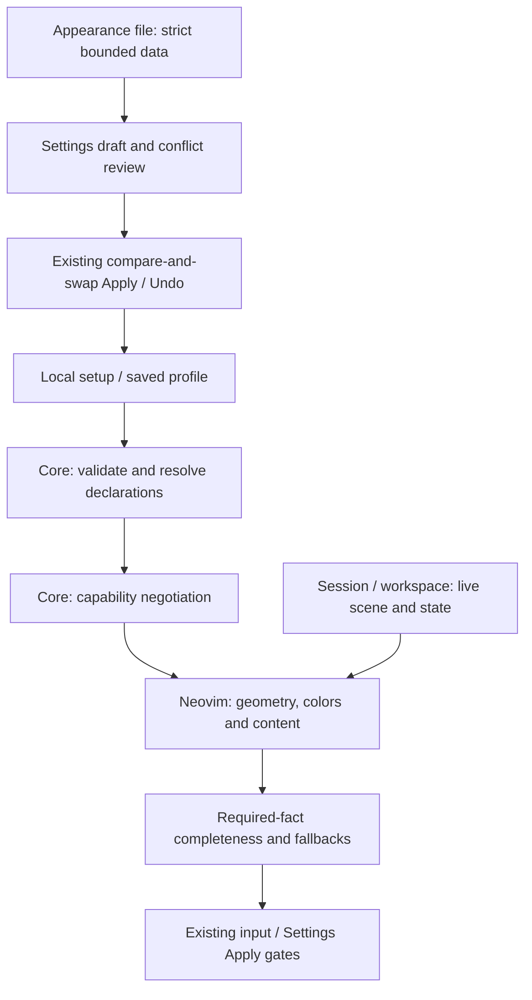

# Presentation contract v1

The source implements portable declarations, Neovim
rendering and optional-information projection in VS Code native controls.
Same-form appearance changes retain semantic ownership. Common typed editing
and file rules serve both hosts; VS Code supplies native authoring/sharing UI.
Neovim capability discovery uses the common declaration and exports use a lazy
lifecycle-bound service. See [compatibility](../compatibility.md) for
host support and limitations.

This document describes maintainer contracts; the
[preset guide](../presentation-presets.md) describes user operations.
The optional VS Code host retains its existing native UI and resolves shared
presets for six scenes. Data-only presentation bridge requests reuse the existing
protocol and C ABI; no Webview or additional host is introduced.

## Data schema

`command_environment.core.presentation` accepts this configuration:

```lua
{
  version = 1,
  selected = 'focused', -- Optional; nil inherits the legacy density.
  presets = {
    focused = {
      name = 'Focused',   -- Optional display name; otherwise the ID.
      extends = 'full',   -- Optional; false selects a standalone factory root.
      information = { title = false, help = false, details = true, status = true, icons = false },
      layout = { density = 'compact', position = 'bottom-right', width = 48,
        max_width = 88, max_height = 16, rows = 6 },
      spacing = { horizontal = 2, vertical = 0 },
      decoration = { border = 'rounded', separator = false },
      roles = { selected = { fg = '#FFFFFF', bg = '#304050' } },
      scenes = { review = { information = { details = true } } },
    },
  },
}
```

All declaration sections and their fields are optional overrides. `presets` may
be omitted and normalizes to an empty object. `selected` must name a built-in or
declared preset. A missing configuration means the empty version 1 configuration;
the sharing envelope separately requires a `presentation` object.

| Section | Fields and accepted values |
| --- | --- |
| `information` | `title`, `help`, `details`, `status`, `icons`: booleans |
| `layout` | `density`: full/compact/minimal; `position`: center/bottom/bottom-right/top/top-right; `width`, `max_width`: integer 1..240; `max_height`, `rows`: integer 1..80 |
| `spacing` | `horizontal`: integer 0..6; `vertical`: integer 0..2 |
| `decoration` | `border`: none/rounded/single/double; `separator`: boolean |
| `roles` | normal/selected/muted/accent/warning/error objects, each with optional `fg`, `bg` in `#RRGGBB` |
| `scenes` | tree/search/input/review/tasks/results objects, each overriding the same five sections |

Color hex digits normalize to uppercase. An empty role does not erase inherited
components; omitted components inherit. Scene overrides cannot declare a name,
parent, selection or another scene. Unknown fields, functions, nonfinite numbers,
invalid UTF-8 and arbitrary metatables are rejected. Core object markers are the
only accepted non-nil metatables. Arrays and JSON null are not object declarations.
No declaration contains executable paths, commands, targets or review permissions.

IDs match `^[a-z][a-z0-9_-]*$`, with a 48-byte ceiling. Display names are nonempty
UTF-8 with no control characters and an 80-byte ceiling. There are at most 32
explicit declarations, including overrides of full/compact/minimal, and at most
four inheritance edges to a built-in or standalone factory root. The normalized JSON configuration
must fit 64 KiB independently of declaration count. All bounds are checked before
the returned configuration can replace host settings.

## Resolution

The built-in roots define these initial values:

| Root | Information policy | Rows | Spacing H/V | Border | Separator |
| --- | --- | --- | --- | --- | --- |
| full | All optional fields true | 16 | 0/0 | rounded | true |
| compact | Title true; other optional fields false | 6 | 0/0 | rounded | false |
| minimal | All optional fields false | 3 | 2/0 | none | false |

All roots start with center position, width 48, maximum width 88, maximum height
16 and theme-inherited roles. These are root defaults, not a guarantee of the
effective screen after legacy values, explicit overrides and viewport constraints.

RE35 0.2.0's Neovim host uses `window.layout = 'fixed'` for an anchored main panel and
an independently bounded details panel. This is host-owned geometry, not a new
field or meaning in the shared preset contract. Mode/scene or viewport changes
can resize the footprint; selection and optional descriptions cannot. Critical
legacy input/review/source views use the same factory-model wrapping and
admission rules as named presets. Separate details never hide required review
targets, partial-result notices or task-report destinations. Native VS Code
controls retain their existing capability/fallback reports.

Resolve in this order:

1. Select explicit requested ID, then configuration selection, then legacy
   density, then Full. Follow declared parents; an undeclared built-in is a root,
   and a custom declaration without a parent inherits configured Full. An explicit
   `extends = false` terminates inheritance at an immutable factory root: Full
   for a custom preset, or its own root for a built-in override. It bypasses
   configured Full declarations and scenes.
2. Start from the root and merge legacy icons, position, width and width/height
   limits. Legacy Compact/Minimal row values apply to the corresponding root.
   Historical legacy geometry above the shared ceiling is clamped to 240 columns
   or 80 rows; this does not rewrite the stored eight-field UI configuration.
3. Merge ancestor-to-child base sections. Color roles merge by component.
4. If a scene is requested, merge ancestor-to-child scene sections. A parent's
   scene value therefore outranks a child's base value until the child overrides
   that scene itself.
5. Return detached full sections plus the selected ID and display name.

Cycles, missing references and excessive depth return an error. Base resolution
with a nil scene is necessary for cloning: flatten the effective base, then copy
each scene's complete effective sections. Storing only current scene differences
would leave a clone exposed to inherited Full scene changes. Do not accidentally
copy the Tree scene into the base. Store clones with `extends = false`; otherwise
even a flattened clone can inherit previously absent foreground/background
components from later configured Full changes.

## Core APIs

All APIs return data detached from caller tables and internal defaults.
Validation/resolution/negotiation failure returns `nil, reason`.

| Function | Result |
| --- | --- |
| `validate(config)` | Normalized configuration, or `nil, reason` |
| `resolve(config, id, scene, legacy)` | Complete `{ id, name, information, layout, spacing, decoration, roles }`, or `nil, reason`; nil scene means base only |
| `builtins()` | Built-in resolved roots, without legacy values |
| `ids(config)` | All built-in/custom IDs in alphabetical order, or `nil, reason` |
| `limits()` | Detached count, inheritance-edge and byte/string ceilings |
| `editor_schema()` | Detached typed group/field catalog, scene/builtin IDs, limits and `data_only` authority |
| `capabilities(host)` | Detached manifest for neovim/vscode, or `nil, reason` |
| `negotiate(resolved, manifest)` | Detached effective model and ordered fallback entries, or `nil, reason` |

Discovery ordering is separate from UI cycling. Session cycles Full -> Compact
-> Minimal -> sorted custom IDs. Base APIs do not save a selection, open a panel
or inspect installed fonts/providers.

## Authoring and file APIs

`command_environment.core.presentation_edit` consumes the same declaration
validator and editor schema; it contains no host API or dispatch authority.

| Function | Result |
| --- | --- |
| `schema()` | Detached `presentation.editor_schema()` data |
| `edit(presentation, action)` | Detached normalized candidate, or `nil, reason` |
| `file_validate(file)` | Detached validated sharing envelope, or `nil, reason` |
| `file_decode(json)` | Strict JSON decode and the same envelope validation, or `nil, reason` |
| `file_encode(file)` | Validated JSON text plus one newline, or `nil, reason` |

Edits accept exact action fields for creation, independent cloning, naming,
parent/selection changes, base or scene field/group/component edits and resets.
Creation inherits its source (Full by default); cloning stores the complete base
and all six resolved scenes with `extends = false`. Deleting a built-in or a
preset with a dependent declaration is refused. Resetting a default removes its
override, while clearing selection restores the host's inherited choice.
Normalization after every action rechecks size, names, references and cycles.
Editing returns data only; a host must stage and review that data before saving.

Protocol 1 / C ABI 1 expose these additive operations:

| Operation | Exact request fields | Success value |
| --- | --- | --- |
| `presentation_capabilities` | `host` | Manifest for the named host |
| `presentation_resolve` | `host`, `presentation`, `scene`, optional `id` | Requested/effective model, manifest and fallbacks |
| `presentation_editor_schema` | none | Typed editor schema |
| `presentation_edit` | `presentation`, `action` | Candidate configuration |
| `presentation_file_validate` | `file` | Sharing envelope |
| `presentation_file_decode` | `json` | Sharing envelope |
| `presentation_file_encode` | `file` | JSON text plus newline |

Unknown request fields are refused. Bridge responses retain the existing
bounded error envelope; semantic refusal does not admit work. The optional
loader/source manifest now contains 17 modules including `presentation_edit`;
older built loaders require replacement before using the added operations.

## Capabilities and fallback

A manifest has `contract_version = 1`, a host name and a `support` object.
Support contains the five sections above, with an explicit boolean for every
field; color support is per role. Core Neovim capability discovery supports all
declared cosmetic preferences. The VS Code native adapter supports
`information.title`, `help`, `details` and `status` for optional content. Its
manifest declines icons, geometry, spacing, decoration and color roles.

```lua
local P = require('command_environment.core.presentation')
local model, reason = P.resolve(config, 'focused', 'review', legacy)
if not model then return nil, reason end
local effective, fallbacks = P.negotiate(model, P.capabilities('vscode'))
-- A declined layout.density entry includes:
-- { path = 'layout.density', requested = 'compact', effective = 'full',
--   reason = 'vscode uses its native presentation for this option' }
```

Unsupported fields use fixed native fallback intent: Full/center/48/88/16/16
layout, zero padding, no border or separator, host-inherited roles and no icons.
Supported information fields retain their resolved preference. Fallback geometry
is a deterministic preference result, not a claim that a native Quick Pick has
those terminal dimensions. Every declined scalar is reported; an empty color
role needs no fallback entry. Entries follow section order and alphabetical
field order.

Neovim also records runtime fallbacks for unsupported inherited legacy placement,
a viewport too small for requested
padding/borders, decorative icons in input/review/narrow panels, and exhausted
concurrent highlight slots. Drawing remains host-owned. Required input and
review facts are tracked separately: if they cannot be represented completely,
submission/Apply is refused until the viewport or spacing is corrected. A
capability boolean never grants execution authority or suppresses this gate.

Required text wrapping is bounded to 4,096 characters and at most one overflow
row beyond the current body height per block. Whole-review representability is
checked independently of the selected page. Settings checks fresh Before/After
facts at Apply even after returning to editing; temporary viewport or selection
changes cannot erase an incomplete fact on another page.
Named-preset input/review submissions refresh the live display before accepting
Enter, preventing a resize while waiting for a key from reusing stale completeness.
The refresh retains the same Session, form and mode; a changed owner refuses it.

## Host ownership and profile boundary



Presentation resolution consumes data. Live navigation and execution ownership
remain in their existing host owners; the renderer does not execute commands.

| Owner | Responsibility |
| --- | --- |
| Core presentation | Strict bounded declarations, inheritance, resolution, static negotiation; no live state |
| Core presentation edit | Typed edit schema/actions and strict appearance-file codec; detached candidates, no save or review authority |
| `presentation_data` | Translate only known core object and Neovim empty-object markers; refuse cycles/foreign metatables |
| Profile/environment | Optional `profile.presentation`, candidate validation and saved selection; command argument `profile.presets` stays separate |
| Settings presentation | Preset authoring, clone/reset/delete, scenes and notes in the existing Settings draft |
| Settings transaction | Review, compare-and-swap Apply, Discard and bounded prior-profile Undo |
| Neovim appearance exports | One lazy lifecycle-bound service behind `export_ui`/`export_presentation`; applied snapshots, destination checks and current-owner validation |
| Session/presenter/workspaces | Existing navigation, selection, text input, review and operation ownership; select the applicable scene |
| Neovim presentation/view | Host geometry, clipping, glyphs, highlight slots, fallback facts and required-content completeness |
| VS Code `PresentationService` | Six-scene resolution/cache, native optional-field projection and checks against the original backend, profile and appearance revision |
| VS Code `NativeView` | One widget/form lifetime, original item identity, refresh leases, validation and explicit gesture handling |
| VS Code `FactsDocument` | Bounded immutable full-text inspection with an owned virtual document provider; no operation authority |
| VS Code appearance editor/files | Private immutable drafts, conflict/support review, serialized storage commit/rollback, one prior-override restoration and bounded exclusive file I/O |
| Presentation export/shared import | Versioned appearance-only snapshots, safe files and unchanged import/source ownership |

In Neovim, profiles override local setup presentation as one collection. Removing
the profile collection returns to local setup. VS Code additionally gives its
saved authored appearance override precedence over profile/local collections;
clearing that override reveals the underlying collection. View changes never replace command IDs,
arguments, callbacks, task/result owners, source context or private Apply receipts.
During a pending Settings draft or Settings-owned callback input before the first
draft, `?`/`F1` changes only session presentation state;
it must not persist a selection and invalidate the draft's optimistic baseline.
Other Neovim view changes save selection through the existing profile store and
report save failures. The VS Code native View button remains session-only as
described below. Text-editing semantics remain host-owned; no Normal-mode key
takeover outside the explicit RE35 entry is introduced.

## VS Code native adapter

`re35.presentation` supplies the machine-local version 1 collection. An applied
portable `profile.presentation` overrides it as one collection, and a saved
authored appearance override takes precedence over both. Clearing that authored
override reveals the profile collection, or local settings if the profile omits
presentation. Requests for
`presentation_capabilities` and `presentation_resolve` return detached data. A
resolution names tree, search, input, review, tasks or results and reports the
requested model, effective information policy, capability manifest and fallbacks.
It opens no operation, selects no command and grants no execution authority.

The native adapter caches at most those six scene keys for one backend, profile
and appearance revision. Concurrent requests for one scene share its pending
resolution. A stale response cannot populate a replacement owner's cache.
`pick` projects display rows into a private view map and returns only the
original item reference for the chosen native row; matching labels or copied
objects do not adopt a proposal, diagnostic or execution receipt. Multiselection
preserves the original item references and refuses duplicate or foreign rows.

Routine titles and explicitly optional helper text may be hidden. Row detail or
description is optional only when its caller marks it as such. Input questions
and validators, invocation identity, original choices/argv/cwd, required review
and save boundaries, task outcome/status, unknown causes and partial/stale
notices remain visible independently of the chosen information policy. Native
widgets own geometry, focus, fonts and text-editing behavior.

The read-only `re35.presentationSupport` command, also available in RE35 discovery
with recorded command path `s u p`, shows the selected scene's requested preferences
and native fallbacks. It changes no settings and admits no work. Native preset
authoring and appearance-only import/export use a saved host-local override.
That override takes precedence over profile/local presentation;
resetting that override reveals profile or local defaults. It does not replace
the workflow profile, project selection or execution owner.

A validated appearance-only `re35.presentation` update keeps the existing
backend, portable profile, project selection, Tasks/Results and private pending
admissions including an active UI review. It replaces only owned appearance data
and refreshes the same `NativeView` widget with a private new display-to-original
map. Query/input and cursor state, active item, multiselection and review receipt
remain owned by the original form. Input cursor state is preserved by leaving
the same native widget's value/selection untouched; the API does not report
the user's later cursor via `valueSelection`. Informational rows cannot submit.
Refresh leases block Enter and mode/inspection buttons without queueing an action.
The view button cycles built-in/custom declarations for this host session only;
replacement local settings, backend/profile replacement or disposal retires that
session choice. A delayed old form's mode callback cannot update a newer form.
Malformed data leaves
the prior appearance intact; an older awaited
validation cannot overwrite a newer update. Profile/backend replacement, trust
loss or disposal also refuses an old choice or input result. These checks
preserve workflow ownership and do not establish visual or physical acceptance.

`FactsDocument` is a lazily registered host-owned virtual text provider. It exposes
the original list label/description/detail in an immutable scrollable document,
including facts native rows may elide. One 1 MiB snapshot and one provider are
retained per presentation service; replaced URIs are refused and service disposal
clears text/provider ownership. No action links, callbacks or receipt fields are
serialized.
Required review text is checked against the same bound before a Run/Apply form
is offered, including the one-shot compatibility facade. Incomplete oversized
facts cannot gain authority merely by skipping inspection.
Inspection verifies the original backend/profile/trust owner before
and after asynchronous document access. It keeps the original form and query,
and does not select, approve, save or run anything. Native pixel readability is a
separate owner judgment; complete text access is not a claim that every row fits.

## Sharing envelope

Appearance files use `{ format = 're35.presentation', version = 1,
presentation = <configuration> }`. The whole file, including the envelope and
export newline, must fit 64 KiB. Export includes declarations and selected preset
only. Legacy inherited UI values stay local; the separate `re35.ui-settings`
format still supports sharing the eight Neovim UI values.

Dedicated appearance import replaces the appearance collection after review; it
does not merge command/profile sections. Existing IDs are reviewed as conflicts,
removed declarations appear in Before/After differences, and Undo retains the
prior Neovim profile or VS Code authored override, respectively. Duplicate JSON keys, unknown fields/versions, array markers,
symlinks, substituted/incomplete files and stale import ownership are refused.
Reading produces a detached snapshot with no execution. Neovim uses its shared
non-overwriting host writer; VS Code uses its own bounded exclusive writer.
Both protect storage and named source paths and recheck the export owner.

The [presentation inspection catalog](../../tests/fixtures/presentation-inspection.json)
provides repeatable scene and viewport cases. The [test guide](../../tests/README.md)
also covers appearance-file round trips and resource comparisons. Controlled
fixtures do not replace checking actual focus, clipping, contrast and font coverage
in the host's UI. See [compatibility](../compatibility.md) for host limitations.
