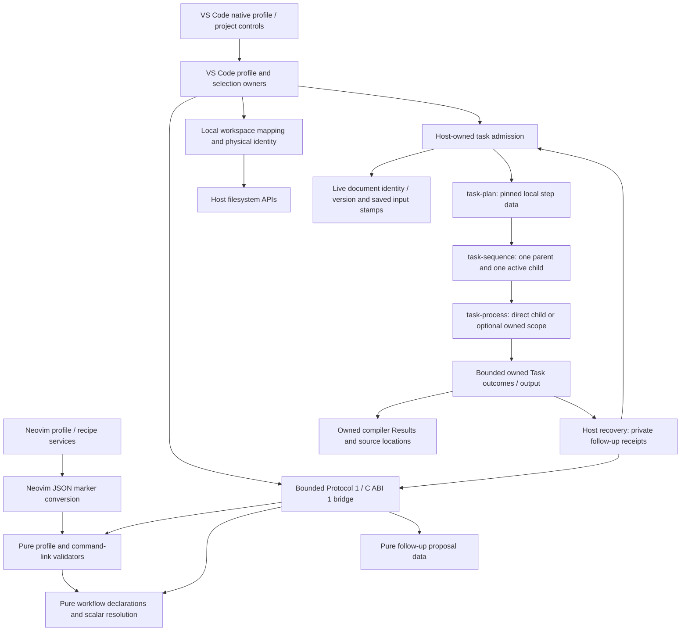

# Shared profiles and host-owned workflow contexts

Status: shared validation, VS Code profile/project selection, sequential recipe
Tasks, cancellation, optional process groups, owned Results, source navigation
and project search are implemented, with original-context recovery, fresh retry,
presentation and appearance authoring/sharing. See
[compatibility](../compatibility.md) for host support and limitations.
Validation and context selection are data operations; neither starts a declared
tool. The configured core helper is a separate trusted host prerequisite.

## Responsibility and flow

The core owns JSON schemas, stable IDs, declaration limits, logical choices and
scalar argv substitution. `workflow.argv` returns data, including an exact empty
argument when declared; it does not authorize a process. The Neovim wrapper
keeps root/cwd resolution, source containment, executable checks, local overrides,
context revisions, saving, execution callbacks and original retry receipts.

The VS Code profile owner retains immutable declarations and a private preview
receipt. The context owner resolves explicit workspace/config/home bases and
retains private physical-identity receipts. The selection owner keeps the chosen
project, recipe, configuration and target with its backend, profile revision and
local-context generation. Text documents and process handles remain host
resources, never portable declarations.

## Additive transport operations

Document v1/v2, Protocol 1 and C ABI 1 retain their existing meaning. These
operations neither register commands nor create engine execution requests:

| Operation | Exact request fields | Result |
| --- | --- | --- |
| `profile_capabilities` | none | Profile/schema version, validated sections, limits, strict JSON support and `data_only` authority |
| `profile_validate` | `profile` | Detached normalized full profile |
| `profile_decode_validate` | `json` | Strict core JSON decoding followed by the same full validation |
| `workflow_choices` | `project`, optional `selection` | Validated configuration and target; omitted values use declared defaults |
| `workflow_argv` | `tool` containing command/optional args; `values` containing file/root/configuration/target | Exact bounded argv, no cwd/shell/process permission |

Unknown request fields, null, explicit arrays in object positions and explicit
objects in list positions are refused. Errors use the existing bridge error
envelope; a semantic refusal does not terminate or shift the helper request queue.
Profile/choice error text is bounded to 8 KiB at a valid UTF-8 boundary so a large
invalid declaration key cannot make its rejection exceed the response frame.
The full profile is validated, including currently unsupported host sections.
Valid references to absent projects/tools remain stored so availability can be
explained when the host consumes them.

Profiles have a 1 MiB JSON bound, 24 levels and 20,000 value nodes, checked before
and after normalization. Workflow limits remain 64 projects, 128 recipes,
16 ordered steps, 64 configuration/target choices and 256 step argv entries.
The existing Protocol 1 JSON codec also bounds numeric magnitude to
`2^53 - 1`; larger finite local preset/UI numbers are refused as nonportable
data. Refusal preserves the original profile/file.

The existing 1 MiB request/response envelope still applies. JSON text nested
inside a request needs escaping, and normalized defaults may enlarge a response.
The host refuses a request that cannot fit; the bridge reserves response envelope
headroom before returning a normalized profile. A valid on-disk profile does not
promise that its escaped form fits a particular transport frame. No document
paging or hidden profile upload session is introduced.

The declaration distinctions remain explicit: tool argv rejects empty entries,
recipe-step argv accepts them; repeated argv entries are valid; tool cwd can
traverse a logical base, while project roots, sources and step cwd cannot use
`..`. All machine executables, mappings and helper paths stay local.

## Profile preview lifecycle

The VS Code entry uses `settings.profile_import`, matching the Neovim ID, with
explicit replacement as its currently supported import mode. Merge is not
implemented in this host. Project selection uses the existing `workspace.project`
ID; different native controls do not create a second identity for that entry.

`read/preview -> pending -> Apply | Discard | superseded | disposed`.

One profile owner has one pending preview. A new preview invalidates the prior
receipt. Every awaited boundary and Apply checks owner lifetime, backend identity,
backend closure, preview serial and the active profile revision. Apply consumes
the private receipt once, increments the profile revision and resets the selected
context. A copied serialized preview is inspection data and cannot be applied.
Discard/failure preserves the active profile and selection.

Reading accepts an explicit absolute local regular file, checks its identity
before opening and after reading, bounds allocation and rejects changed,
nonregular, symlinked and invalid UTF-8 data. The core decoder rejects duplicate
JSON keys rather than allowing JavaScript parsing to discard them. Apply uses
the immutable reviewed snapshot; it does not reread or write the source file.

Unsupported sections have explicit support feedback and remain unchanged in
the active profile. The `project_search` adapter selects the implemented builtin
or optional ripgrep provider. Presentation preferences apply to supported
optional content, with explicit native style/geometry fallbacks. Other adapters,
layout/workspaces, argument presets, slots/favorites, Neovim's eight-field UI and
command links remain stored without activating those behaviors. Profiles live for the owning RE35 host
service; configuration replacement or extension reload clears them. Import does
not install persistent settings or automatically reactivate
a file on startup.

## Project selection lifecycle

`logical choices -> physical inspection -> commit selection -> inspect`.

A single local workspace folder provides the `project` base by default. Multiple
folders require an exact local project-ID to workspace-folder-URI mapping. An
explicitly missing mapping, virtual folder or missing base is explained and
refused. `config` and `home` bases require explicit absolute local settings;
the host does not guess a user directory. Portable relative paths normalize
separators; physical root/source containment is checked after resolving links.

Selection checks profile/backend/context ownership around core and filesystem
awaits, and revalidates physical identity before commit. Foreign, discarded or
superseded receipts cannot commit. Workspace-folder changes invalidate selection;
RE35 configuration changes retire the owning host. Inspect revalidates the
retained context and never starts a task.

Physical identity is distinct from content revision: editing the same source
file retains its identity and is permitted between completed executions. Current
recipe admission captures fresh document/file versions. Sequential execution
refuses changed input before launching another step. Task context must
not inherit document-search snapshot size limits.

## Helper initialization ownership

One startup promise admits all concurrent `Host.core()` callers. The backend is
published only after every command is registered. A disposed host or lost trust
cannot publish the pending backend; disposal also closes the startup helper.
Old reviews keep their exact backend identity and cannot become valid through
automatic helper replacement. Closing a command picker is separate from host
disposal and from explicit recipe cancellation.

The bridge loads profile/workflow rules on their first data operation. Document
operations and profile capability metadata do not require those optional rule
files during initialization. First use applies the same shared validation; lazy
loading grants no execution and changes no module allowlist.

Relevant checks accompany each slice. Actual editor API checks, controlled
[resource measurements](../../tests/README.md#vs-code-resource-comparison), physical UI inspection
and human usefulness observations are separate evidence.

## Sequential task admission and results

The VS Code host implements sequential `project.run_selected_recipe`,
`run.tasks` and `run.cancel`.
`workflow_argv {tool:{command,args?},values:{file,root,configuration,target}}`
returns bounded exact argv through the same Lua substitutions used by Neovim.
It is data only; cwd, shell options and process authority are not request fields.
Document v1/v2, Protocol 1 and C ABI 1 remain unchanged.

`prepare -> explicit dirty-input choice when needed -> revalidate -> claim ->
owned launch -> actual close -> revalidate next step or finish -> core completion
-> retained outcome`.

The Task service owns private one-use receipts, executable/cwd identity, input
file stamps and exact live TextDocument objects. Profile/context/backend/tool
settings are checked around awaits. A copied receipt cannot dispatch. One active
task and one pending admission are permitted; four outcomes are retained. Core
claim records a command state and does not authorize a filesystem action. The
host checks current trust, roots, source, executable, cwd and inputs again before
launch. Root/source replacement requires a new selection; an atomic Save that
replaces source identity can therefore save successfully while refusing launch.
The message preserves saved paths and never suggests the process ran.

Only original relevant modified file documents may be selected for Save. Nested
project markers match the Neovim host (`.git`, `compile_commands.json`,
`CMakeLists.txt`, `package.json`, `Cargo.toml`, `pyproject.toml`). Capture bounds
are 1024 candidate documents, 256 relevant documents, 4096 inspected directories
and 128 ancestor levels. Documents are checked again after the final asynchronous
capture. Selected disk stamps are checked immediately before each Save; successful
save participants may advance selected versions. Unsaved/other document changes,
closed/reopened owners, missing inputs and failed saves stop admission.

Portable tool declarations remain shared. Machine overrides replace tool
command/args/cwd; step args/cwd take precedence. Executables resolve on the local
PATH or from an explicit absolute override and are revalidated by identity/stamp.
No relative PATH entry or implicit shell is used. A batch script requires an
explicit interpreter. This host supports at most 256 argv entries after the
executable; a logical cwd escaping its base needs an explicit local cwd override.

The parent captures at most 1 MiB of stdout/stderr combined across all steps, keeps valid
UTF-8 output prefixes, and distinguishes success, nonzero failure, launch failure
and requested direct cancellation. Immutable terminal data releases raw buffers.
Task provenance retains project/recipe/step/tool, effective command and argv/cwd,
configuration/target, profile/context revision, saved paths and unsaved inputs.
Output renderer failure cannot change the process outcome or authorize a retry.
Read-only output URIs include their exact host owner; another host or evicted
task cannot supply their output. Core completion uses small outcome metadata,
not the full output payload. A lost completion is reported separately from the
observed process outcome.

`task-plan.js` resolves portable data into pinned executable/base identities;
`task-sequence.js` owns one active child across at most 16 steps;
`task-service.js` owns one-use admission, private context and once-only core
completion. Resolved step metadata/argv has one combined 1 MiB parent data bound;
this prevents repeating a large tool declaration across 16 steps from retaining
16 independent maximum-size plans. Step snapshots retain IDs and actual argv/cwd. A failed step stops
later steps. Missing later logical directories may be created by configure;
the existing base is pinned at preparation and physical containment is checked
before that child's launch. Tools must already be available; no inferred
dependency or automatic installation is introduced.

Admission requires the current selected receipt. After admission, changing the
current configuration/target does not retarget the original Task. Before each
later child, its original profile/backend/context, local tool/base settings,
root/source/executable/cwd identities and relevant inputs are revalidated around
awaits. Context invalidation requests cancellation. Closing a picker/output view
does not cancel a launched task. Old callbacks cannot regress a completed child
or start another step after cancellation/owner loss.

`processHelper` is an optional explicit local path to `ce_process_scope`.
Missing/broken configured helpers fail without direct fallback. The native
Windows Job/Linux process-group receipt uses the existing version-1 contract;
the wrapper reads at most 4096 bytes from its private regular status file and
cleans up its owned status directory. A cancellation request and an observed
terminal result are separate. Direct scope confirms only child close; descendant
scope is unknown. Once the native launcher starts, scoped termination requires
actual helper close and a valid confirmed receipt; absent or invalid evidence
never claims success. Cancellation before launcher spawn instead records a
quiescent no-child outcome. Scoped `started` records native launcher spawn,
not a separate acknowledgement that the original tool began executing.

Local tool `timeout_ms` (0–86400000, default disabled) and `cancel_grace_ms`
(0–60000, default 2000) govern each child. The scoped timeout clock starts at
native launcher spawn. Timeout requests cancellation and
escalation after grace. Native helper grace is at least 1 ms. Force is available
after cancellation grace, not before. Intentionally detached services remain
outside the owned group; known observations and unknown scope remain explicit.
Host/helper teardown requests owned termination and prevents a next launch.

Supported compiler locations and owned search results follow the
[Results/search contract](results-search-contract.md). Original-task retry
follows the [recovery contract](task-recovery-contract.md).
See [compatibility](../compatibility.md) for host support and limitations.

Direct-child exit can leave inherited output pipes open in unowned descendants.
The wrapper drains for at most two more seconds, closes those pipes, and marks
`outputIncomplete` rather than hanging Task completion or signalling arbitrary
PIDs. Direct descendant termination remains unknown. A forced Linux group can
lose its session anchor's root-result frame: confirmed group cancellation remains
cancellation, while raw receipt code 125/signal 0 is exposed as an unavailable
root exit code with the raw receipt retained. Unsolicited anchor loss remains an
error. This does not expand ownership to deliberately detached services.
